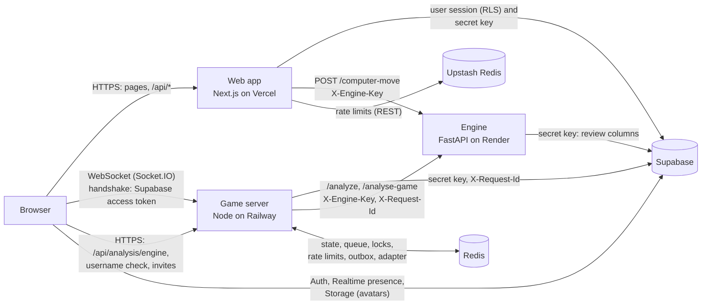

# GAMBIT architecture

Three deployable services plus Supabase:

| Service | Stack | Deployed to | Owns |
|---|---|---|---|
| `frontend/` | Next.js 16 App Router, React 19, TypeScript | Vercel | UI; route handlers for auth, profile, friends, notifications, game history, private-game creation, leaderboard, the computer opponent proxy |
| `server/` | Node 26, Express 5, Socket.IO, CommonJS | Railway | Live games: socket identity, matchmaking, moves, clocks, results, rating, review trigger, chat, challenges and rematches |
| `chess-engine/` | FastAPI, python-chess, Stockfish, PyTorch | Render | Position analysis, full-game review (writes the review columns), the MAVERICK computer opponent |
| `supabase/` | Postgres + Auth | Supabase | Persistent data, RLS, `public.apply_game_result`; schema changes only via `supabase migration new` (SEC-08) |

The rules every change must follow are in [`docs/ENGINEERING_RULES.md`](ENGINEERING_RULES.md).
Decisions: [`docs/refactor/DECISIONS.md`](refactor/DECISIONS.md) (refactor) and
[`docs/fixes/DECISIONS.md`](fixes/DECISIONS.md) (fix phases, F-001 onward).
Deployment and every environment variable: [`DEPLOY.md`](../DEPLOY.md).

## Components



## Where state lives

| State | Where | Notes |
|---|---|---|
| Accounts, sessions | Supabase Auth | Session cookies set by the web app's route handlers (`@supabase/ssr`) |
| Profiles, ratings, statistics | `public.profiles` | Ratings and stats are written only by `public.apply_game_result` |
| Games, moves, chat, friendships, notifications | `public.games`, `moves`, `messages`, `friendships`, `notifications` | `games` holds result, final clocks (`white_clock_ms` / `black_clock_ms`) and the review |
| Invite tokens | `public.game_invites` | Service role only; never on the `games` row |
| Live game state | Redis `game:<id>` (24 h TTL) + `active_games` set | Updated by compare-and-set, never by blind writes |
| Matchmaking queue | Redis `{mm}:queue` (sorted set) + `{mm}:entry:<user>` | Pairing pass under `{mm}:pairing-lock`, multi-key writes in Lua |
| Pending challenges and rematches | Redis, 60 s TTL | An accept must match a stored request |
| Clock tick ownership | Redis `clocktick:<id>` (`SET NX PX`) | One replica ticks each game |
| Rate limits | Redis (game server); Upstash `gambit:rl:*` (web app) | Both fail open |
| Results the database refused | Redis `{outbox}:*` | Re-driven by a worker (DEPLOY.md §4b-3) |
| Socket.IO rooms across replicas | Redis Streams adapter | `SOCKET_ADAPTER=redis` (default) |
| Online presence | Supabase Realtime presence channel `gambit-online-users` | |

No game state lives in the game server's process memory, so it can run as several replicas
(DEPLOY.md §4b-2). The only in-process state is the socket session registry of that replica's own
connections.

## Game server (`server/`)

```
server.js            shim: require('./src/index'), start() only when run directly
src/index.js         composition root: wires config, clients, repositories, services, http, sockets
src/config/          env.js (the only reader of process.env, call-time accessors), origins.js
src/domain/          pure functions: timeControl, clock, clockVerdict (first-move, flag, abandonment),
                     gameState, result, adjudication, chessRules (chess.js), moveAuthorization,
                     pgn, gameDto, rating/glicko, matchmaking/pairing, rateLimits, redrivePolicy,
                     accessToken  (no I/O)
src/clients/         engineClient (fetch + X-Engine-Key), supabaseClient, redisClient, redisCommands,
                     socketAdapter (Redis Streams), healthProbes, webhookErrorReporter
src/repositories/    gameState (Redis, compare-and-set), matchmakingQueue (+ Lua scripts),
                     pendingRequests, tickLock, rateLimit, gameResultOutbox (+ Lua scripts),
                     games, gameResults (apply_game_result), gameInvites, moves, messages,
                     profiles, notifications
src/services/        game, moveRecorder, gameFinalizer, gameResultEffects, clock, matchmaking,
                     rating, privateGame, social, chat, review, analysis, profile, tokenVerifier,
                     originPolicy, rateLimiter, readiness, resultOutboxWorker; emitter port over io
src/http/            app.js (origin check, CORS, request ids, one error middleware), routes/
                     (status, games, users, analysis), middleware/requireUser.js, rateLimit.js
src/sockets/         index.js (websocket-only server), auth.js (handshake token → socket.data.userId),
                     tokenLifetime.js, schemas.js (zod per event), wrap.js (validate, catch, ack),
                     rateLimit.js, handlers/{session,lobby,game,chat,social}.js, sessionRegistry.js
src/observability/   log.js (pino JSON), requestContext.js (X-Request-Id), errorReporter.js
src/shutdown.js, src/processHandlers.js   SIGTERM drain, fatal-error exit
supabase.js, lib/redis.js, lib/gameStore.js, services/*.js
                     legacy module paths kept as thin facades: the test suites jest.mock these
                     paths, and src/index.js obtains infrastructure through them
```

### Dependency rules (enforced by `server/.dependency-cruiser.cjs`, all at `error`)

```
http/, sockets/  ──▶ services/ ──▶ domain/
                        │
                        └── receive repositories/ and clients/ by injection
repositories/, clients/ ──▶ @supabase/supabase-js, ioredis, fetch
```

- `domain/` imports nothing from other layers or SDKs (SOLID-07).
- `services/` never import repositories, clients or SDKs; they get them as factory
  arguments from `src/index.js` (SOLID-06, SOLID-08: plain factories, no container).
- Only `repositories/` and `clients/` touch Supabase, ioredis or `fetch`
  (ESLint `no-restricted-globals` for `fetch` outside `clients/`).
- `http/` and `sockets/` call services only (NODE-03, SIZE-05).
- No import cycles (SOLID-12).

### Trust boundary

- **Identity:** `io.use` verifies the Supabase access token from the handshake; every handler
  acts as `socket.data.userId`. No event or payload names the acting user (NODE-10, F-004). A
  socket is closed when its token expires; the client reconnects with a fresh one (F-041).
- **Input:** every event payload is parsed by its zod schema inside `wrap()`; handlers ack
  `{ ok: false, error }` instead of throwing (NODE-07, NODE-08).
- **Moves and results:** the server validates each move with chess.js against its own state,
  adjudicates the position, and is the only thing that can end a game (NODE-11, NODE-16).
  Every ending (move, resignation, flag fall, abandonment, first-move timeout) goes through the one
  finalizer, which moves the game active → completed once (NODE-18, F-008, F-029).
- **Rating:** computed in `domain/rating/glicko.js`, applied once per game by
  `public.apply_game_result` in one transaction (F-053).
- **Rematch / challenge:** requests are stored in Redis for 60 s; an accept or decline must
  match one, and the game is built from the stored terms (F-006).
- **Origins:** one `CORS_ORIGINS` allow-list for HTTP and the socket handshake (F-045).

## Frontend (`frontend/`)

```
proxy.ts              session refresh + optimistic redirect for the protected pages only
                      (allow-list matcher); never the only auth check (NX-09)
app/**/page.tsx       thin compositions
app/api/**/route.ts   parse → requireUser() → lib/server data function → DTO response
features/<feature>/   components/, hooks/, state/, utils, one folder per feature:
                      game, lobby, profile, analysis, navigation, offline, game-result,
                      auth, challenge, join, leaderboard, landing, settings, knight
lib/server/           server-only (`import 'server-only'`): Supabase client factories,
                      identity (requireUser / requireFreshUser), env, engine, rate limits
                      (Upstash), validation (zod), DTOs, per-entity data functions
lib/api/              typed client-side fetch helpers per feature
lib/socket/           the realtime connection (handshake token, websocket-only, ack timeouts)
lib/supabase/         browser client and the public key reader
lib/chess/            pure chess helpers (board coords, clock format, time controls, outcome)
lib/safeRedirect.ts   the one post-sign-in redirect check (same-origin path, F-051)
lib/imageHosts.json   next/image remote hosts (shared with next.config.js)
types/                shared domain and socket payload types (no runtime code)
components/           app-wide providers (Socket, Profile, Presence), Navbar, Toast, ui/
```

- `requireUser()` trusts the **verified** claims of the access token (`auth.getClaims()`);
  `requireFreshUser()` also asks Supabase Auth (`getUser()`) and guards account changes (F-025).
- Pages compose hooks and components; hooks own effects and socket wiring;
  components are presentational and receive callbacks, never the socket (SOLID-02, SOLID-05).
- The socket comes only from `useSocket()` in `components/SocketProvider`.
- `server-only` modules can't be imported by client code (build error).
- Profile edits run as the signed-in user under RLS; the secret key is used for reads and for
  writes RLS does not allow (signup profile row, private games, invites, friendships, notifications).

## Chess engine (`chess-engine/`)

```
main.py             FastAPI app (composition root); includes routers; `uvicorn main:app`
config.py           the only reader of env vars; named limits (MIN/MAX_ANALYSIS_DEPTH = 1/20)
auth.py             X-Engine-Key shared-secret check for every route but /health
seams.py            late-bound dependency lookup through `main`
engine.py           Stockfish pool (bounded admission: busy → 503 "Engine busy" + Retry-After)
computer_engine.py  MAVERICK computer opponent: style model supervised by Stockfish
style_engine.py     style-model loading and /style-move
model.py            style policy network and board encoding; weights in style_model.pt
routers/            health, moves, fen (FEN/move validation), analysis, computer  (APIRouter)
services/
  perspective.py    the one evaluation-perspective convention (scores are White's view)
  analysis.py       move scoring and classification
  review.py         full-game review pipeline; writes the review columns of `games`
  rereview.py       re-run stored reviews (used by scripts/rereview_games.py)
  model_store.py    fetch and SHA-256-verify the MAVERICK weights (fallback download)
scripts/            operator commands (`python -m scripts.rereview_games`, DEPLOY.md §10)
tests/              pytest; Stockfish faked (FakeStockfish), real-binary tests skip without one
Dockerfile          the runtime (Python 3.11, requirements.txt, Debian Stockfish)
```

Endpoints: `GET /health` (public), and behind `X-Engine-Key`: `POST /analyze`, `/analyse-game`,
`/classify-move`, `/validate-move`, `/valid-moves`, `/computer-move`, `/style-move`,
`GET /style-move/health`.

## Shared definitions (`shared/`)

`shared/time-control.json` is the one definition of the time-control model (limits, category
thresholds, lobby presets, contract cases). Each deployable carries a copy
(`server/src/domain/timeControl.data.json`, `frontend/lib/chess/timeControl.data.json`) written
by `node scripts/sync-shared.js`; a test on each side fails when a copy differs (F-027). Edit the
file in `shared/`, never a copy.

## Main flows

**Sign-in.** The login form posts to `POST /api/auth/login` (rate-limited per IP and per e-mail).
The route handler signs in with Supabase and sets the session cookies on its response. `proxy.ts`
refreshes the session on protected pages; each route handler calls `requireUser()`. After sign-in,
`SocketProvider` opens one socket with the browser session's access token in the handshake.
Google sign-in returns through `/auth/callback`.

**Matchmaking.** `join_queue { time_control, increment, is_rated }` (acked) adds the user to the Redis
queue. Every second one replica (holding the pairing lock) pairs compatible entries
(`domain/matchmaking/pairing`), takes them off the queue with a Lua script, inserts the `games` row and sends `match_found` to both players; both open `/game/<id>`. Private games: the web app
creates the game and a `game_invites` token; the second player joins through the game server's
`POST /api/games/join/:token`, which sends `game_start`.

**A move.** The client emits `make_move { game_id, from, to, promotion? }` and waits for the ack. The
server checks the turn and legality with chess.js against the Redis state, applies it with
compare-and-set, records it in `moves` and the clocks on `games`, and broadcasts `move_made` (FEN, SAN,
clocks) to the game room on every replica. A refused move gets `move_rejected` and a `game_state_sync`.
White's first move starts the clocks; each side has 30 s for its first move, or the game is aborted
unrated (F-031).

**Game end, rating, review.** Checkmate, stalemate and draws are detected after each move;
resignation, flag fall (clock ticker, one replica per game) and abandonment end through the same
finalizer. It writes the `games` row once (guarded on `status = 'active'`, 3 retries, then the result
outbox), broadcasts `game_end`, calls `apply_game_result` and broadcasts `rating_updated`, then asks the
engine for a review (`/analyse-game`, fire and forget). The engine reviews the game in the background and
writes accuracy, classifications and critical moments to the row; the result page polls
`GET /api/games/<id>` until they appear.

**Reconnect.** A dropped client reconnects with a fresh token in the handshake, re-joins its game
(`join_game`) and gets `game_state_sync` from Redis; the opponent sees `opponent_disconnected` with a
20 s countdown and then `opponent_reconnected`. A disconnect charges time once and a reconnect never
starts a clock (F-030). If the player's last socket at that board stays gone for the grace period, the
game ends by abandonment (or is aborted if both sides have not moved yet, F-032). A queued player is
re-queued with the same terms on reconnect (F-077). On a server shutdown the client gets
`server_shutdown` and reconnects to another replica.

## Observability

- pino JSON logs (`LOG_LEVEL`); each HTTP request gets an `X-Request-Id` (kept if sane, else a new
  UUID), echoed in the response and sent to the engine and Supabase; socket handler logs carry
  `socketId` / `userId`.
- `/livez` (and `/api/health`) for liveness, `/readyz` (Redis and Supabase within 2 s, not draining)
  for readiness; Railway health-checks `/readyz`.
- Errors go to an error-reporter port; with `ERROR_WEBHOOK_URL` they are POSTed to a webhook.
- `SIGTERM` drains within 20 s; fatal errors exit for a restart.

## How to add a feature

1. **Pure rules first.** Put chess/clock/rating logic in `server/src/domain/` or
   `frontend/lib/chess/` with unit tests (TEST-03).
2. **Data access.** Add a repository function (server) or a `lib/server/` data
   function (frontend). Keep queries there and nowhere else.
3. **Service.** Add or extend a service factory that receives its repositories
   and clients as arguments; unit-test it with plain fakes.
4. **Entry point.** Add a thin socket handler / Express route / Next.js route
   handler: validate input → identify the caller → call the service → respond.
   Never trust ids, ratings or results from the client (NODE-10/11/16, NX-07).
5. **UI.** Add `features/<name>/` hooks and components; keep `page.tsx` a composition.
6. **Database.** `supabase migration new <name>`, with pgTAP tests in `supabase/tests/` when it
   touches RLS, privileges or functions.
7. **Gates.** The per-package commands in [`setup.md` §7](../setup.md#7-tests-and-gates).
   Lint baselines are empty: every file must pass the size and complexity limits (SIZE-01..04).
